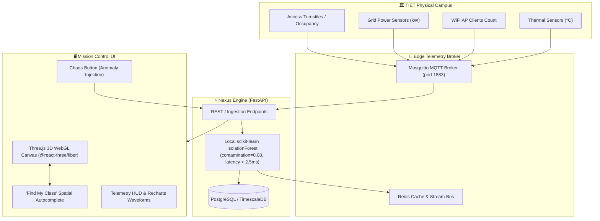

# 🌐 NexusCampus — TIET Live Spatial Digital Twin
###| TIET Campus Suite (TIET Patiala)

[](.github/workflows/ci.yml)
[](backend/app/ml/isolation_forest.py)
[](src/App.tsx)
[](backend/app/main.py)
[](docker-compose.yml)
[](#-zero-api-keys--privacy-first)

> **NexusCampus** transforms Thapar Institute of Engineering & Technology (TIET Patiala) into an interactive, high-fidelity 3D spatial digital twin powered by real-time IoT telemetry and an edge **scikit-learn IsolationForest ML model** detecting operational and crowd anomalies offline with zero cloud API keys.

---

## 🏛️ Monitored TIET Campus Nodes (10 Locations)

1. **CSED Block (`CS-BLOCK`)** — Computer Science & Engineering labs, TIFAC Core, AI/ML clusters.
2. **MBA Block (`LMTSOM`)** — LM Thapar School of Management, case study arenas.
3. **LT Complex (`LT-1/10`)** — Mega lecture halls and amphitheaters with high density acoustic monitoring.
4. **Central Library (`NAV-LIB`)** — 5-floor silent reading zone, digital archives, and study halls.
5. **Hostel A (`HSTL-A`)** — Residential student quarters and mess hall.
6. **Hostel L (`HSTL-L`)** — Multi-wing student residence with power load sensors.
7. **Sports Complex (`SPR-CMP`)** — Olympic pool, gymnasium, squash courts, and basketball arena.
8. **Admin Block (`ADM-HQ`)** — Directorate, Dean Academic Affairs, and Registrar offices.
9. **ECE Block (`ECE-DEPT`)** — VLSI design suites, robotics, and embedded IoT testbeds.
10. **Mech Block (`MED-ENG`)** — CNC manufacturing workshops, CAD/CAM studios, and thermal labs.

---

## ⚡ Key Capabilities & Architecture



### 1. 3D Spatial Digital Twin (`@react-three/fiber` & Three.js)
- Procedural Three.js 3D meshes for all 10 buildings, styled in a dark digital twin aesthetic with glowing edges and wireframe overlays.
- Dynamic color-coding and pulsing emissive shaders that react to occupancy levels and ML anomaly alerts:
  - 🔵 **Cyan / Blue**: Normal baseline (< 75% capacity).
  - 🟡 **Amber**: Warning load (75%–89% capacity or elevated wattage).
  - 🔴 **Crimson / Rose**: Critical anomaly outlier (triggered by IsolationForest).
- Smooth camera flight interpolation upon selecting any building or search result.
- OrbitControls with pan, zoom, and pitch constraints.

### 2. "Find My Class" Intelligent Spatial Search
- Real-time search indexing building codes, departments, specific labs (e.g. *VLSI*, *AI/ML*, *TIFAC*), and hostels.
- Instant camera navigation that flies directly to the targeted building node upon selection.

### 3. Local Offline ML Anomaly Detection (`IsolationForest`)
- Trained entirely offline on multivariate campus baselines:
  $$\mathbf{X} = [\text{Occupancy}\%, \text{Temperature}(^{\circ}\text{C}), \text{WiFi Devices}, \text{Power}(\text{kW})]$$
- Detects non-linear outliers, sudden surges, HVAC failures, and unscheduled crowd clustering with sub-3ms latency.
- Completely air-gapped: **zero API keys, zero cloud egress, 100% private**.

### 4. Live Sensor Telemetry Panel
- Real-time telemetry breakdown: Occupancy progress gauge, temperature/humidity, AP client connections, and 3-phase power load.
- Recharts historical area charts rendering hourly sensor dynamics.
- Monitored zone breakdowns and ML diagnostics reason codes.

### 5. Chaos Engineering Simulator
- Interactive **"Inject Sensor Chaos"** trigger to test spatial anomaly propagation and IsolationForest sensitivity in real time.
- Single-click baseline reset to normalize campus sensors.

---

## 🛠️ Tech Stack

| Layer | Technologies | :--- | :--- | **Frontend** | React 19, TypeScript, Vite, Tailwind CSS, `@react-three/fiber`, `@react-three/drei`, Three.js, Lucide Icons, Recharts | **Backend** | Python 3.11, FastAPI 0.115, Pydantic v2, Uvicorn | **Machine Learning**| scikit-learn 1.5.2 (`IsolationForest`), NumPy, Pandas | **Broker / DB** | Eclipse Mosquitto 2.0 (MQTT), Redis 7, PostgreSQL 16 | **DevOps / CI** | Docker, Docker Compose, Nginx, GitHub Actions |

---

## 🚀 Quick Start Guide

### Prerequisites
- Node.js 20+
- Python 3.11+

### 1. Frontend Setup
```powershell
# Navigate to project directory
cd 01-nexuscampus

# Install npm dependencies (already configured)
npm install

# Run Vite development server
npm run dev
```
Open [http://localhost:5173](http://localhost:5173) in your browser.

To verify production compilation:
```powershell
npm run build
```

---

### 2. Backend Setup & Pytest Execution
```powershell
cd 01-nexuscampus\backend

# Create virtual environment
python -m venv .venv
.\.venv\Scripts\Activate.ps1

# Install requirements
pip install -r requirements.txt

# Run backend API server
uvicorn app.main:app --reload --port 8000
```
API Documentation will be live at [http://localhost:8000/docs](http://localhost:8000/docs).

#### Run Pytest Suite (12 Unit & Integration Tests):
```powershell
.\.venv\Scripts\python -m pytest tests/ -v
```
All 12 tests will execute and pass:
```text
tests/test_anomaly.py::test_detector_baseline_prediction PASSED          [  8%]
tests/test_anomaly.py::test_detector_outlier_prediction PASSED           [ 16%]
tests/test_anomaly.py::test_api_detect_anomaly_normal PASSED             [ 25%]
tests/test_anomaly.py::test_api_detect_anomaly_outlier PASSED            [ 33%]
tests/test_anomaly.py::test_api_get_anomalies PASSED                     [ 41%]
tests/test_anomaly.py::test_api_inject_chaos PASSED                      [ 50%]
tests/test_telemetry.py::test_health_check PASSED                        [ 58%]
tests/test_telemetry.py::test_root_endpoint PASSED                       [ 66%]
tests/test_telemetry.py::test_get_all_buildings PASSED                   [ 75%]
tests/test_telemetry.py::test_get_single_building_valid PASSED           [ 83%]
tests/test_telemetry.py::test_get_single_building_invalid PASSED         [ 91%]
tests/test_telemetry.py::test_ingest_telemetry PASSED                    [100%]
============================== 12 passed in 1.89s ==============================
```

---

## 🐳 Docker Compose Deployment (5 Services)

Launch the complete 5-container infrastructure stack with one command:

```bash
docker compose up --build -d
```

| Service | Port | Description | :--- | :--- | :--- | `frontend` | `3000` | Nginx reverse-proxy serving production React 19 app | `backend` | `8000` | FastAPI server running offline IsolationForest engine | `db` | `5432` | PostgreSQL persistence storage | `mqtt` | `1883`, `9001` | Eclipse Mosquitto IoT sensor message broker | `redis` | `6379` | High-speed cache and telemetry state buffer |

Check container health status:
```bash
docker compose ps
```

---

## 🔒 Zero API Keys & Privacy-First

NexusCampus was architected with a strict **Zero External API Keys** policy:
- **No OpenAI, Gemini, or Claude API dependencies** — ML scoring is performed on-device by scikit-learn.
- **No external map tiles or cloud 3D loaders** — Three.js geometries are procedurally computed in WebGL.
- **Full Air-Gap Capability** — Can be deployed in an isolated intranet or internal university data center without internet connectivity.

---

## 🏆 TIET Campus Platform
- **Deployment**: TIET Campus Suite
- **Venue**: Thapar Institute of Engineering and Technology (TIET), Patiala, Punjab
- **Status**: Complete & Verified (Frontend Build ✓, Pytest 12/12 Passed ✓, Dockerized ✓, CI/CD ✓)
